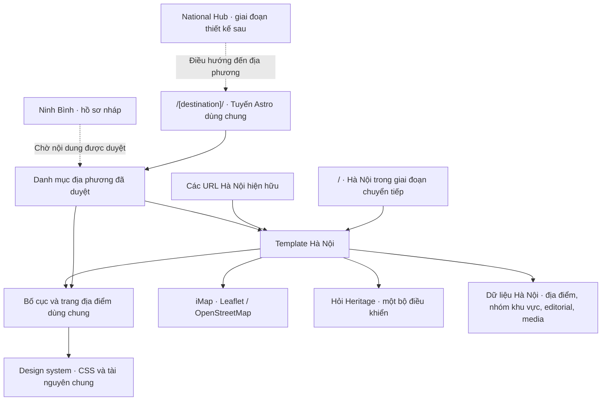

# Kiến trúc Heritage iMap toàn quốc

## Kiểm kê và mốc khôi phục

Nguồn Sites ở `d80a433` (nhánh `main`) đã bao gồm bản trên máy `fe6038b` và bảy cập nhật sau đó về trang Heritage, logo và đầu trang. Bản sao trên máy có nhánh `fix/dinh-le-gallery` sạch. Bản sao làm việc trên Sites sạch trước khi tạo nhánh `refactor/national-platform` và mốc `checkpoint/national-platform-baseline`.

Astro 7.3.8 dựng HTML tĩnh bằng Node 24.22.1. TypeScript 6.0.3, Leaflet 1.9.4, ô ảnh OpenStreetMap, video YouTube và tài nguyên ảnh trong `public/images/`. Nguồn Sites có 54 tệp public, 37 tệp kiểm thử và 10 trang dựng sẵn. `/` là trang chủ Hà Nội, chứa hero, bản đồ nhúng, nội dung Heritage, chuyên mục và điều hướng theo anchor. `/imap/` chạy bản đồ đầy đủ với `?place=<slug>`; `/imap-prototype/` chạy biến thể khám phá; `/heritage-mach-ban/` chứa bộ gợi ý và bản đồ nhúng; sáu `/places/<slug>/` dựng từ danh mục gốc.

Các phần dùng chung đã có gồm icon, lớp hiển thị ảnh/video, hàm khoảng cách, kiểm tra media, trạng thái bộ lọc và công cụ Leaflet. Những phần gắn chặt với Hà Nội gồm logo và điều hướng layout, các hero, chuyên mục, danh mục địa điểm, nhóm khu vực, bản đồ mặc định, editorial, logic gợi ý và câu trả lời Hỏi Heritage. Một phần dữ liệu bản đồ lấy từ hồ sơ thẩm định trong `output/sprint-05a/`. Các bộ kiểm thử cũ có assertion theo đường dẫn mã nguồn, markup hoặc bản dựng.

## Kế hoạch di chuyển

1. Chuyển trang Hà Nội sang các template dùng lại giữa tuyến cũ và tuyến mới. Để tuyến cũ dựng đầy đủ nhằm giữ bookmark, query, anchor và khả năng hoạt động của host tĩnh.
2. Tách bố cục và thành phần trình bày dùng chung khỏi dữ liệu địa phương. Đặt metadata, logo, điều hướng và danh mục Hà Nội trong gói dữ liệu địa phương. Dùng slug địa điểm hiện tại làm ID ổn định trong phạm vi địa phương.
3. Đăng ký Hà Nội và giữ Ninh Bình ở trạng thái chờ nội dung đã duyệt. Dành `/` cho National Hub trong đợt thiết kế sau, giữ trang chủ Hà Nội ở `/` trong bản phát hành chuyển tiếp.
4. So sánh bản dựng trước và sau, giữ nguyên điều kiện trong các kiểm thử đã có và bổ sung kiểm thử cho tuyến tương thích và cô lập dữ liệu.

## Kiến trúc của bản dựng chuyển tiếp



Một repository, một bản dựng tĩnh và một Site. Astro sinh các tuyến từ danh mục ở thời điểm dựng. National Hub sẽ đọc danh mục địa phương để tạo mục khám phá và bản đồ tổng quan Việt Nam. Kiến trúc giữ phần tài nguyên và POI chi tiết ở lớp địa phương. [Tuyến Astro](https://docs.astro.build/en/guides/routing/), [thành phần Astro](https://docs.astro.build/en/basics/astro-components/).

```text
src/
├── pages/                            Điểm vào Astro và các tuyến tương thích
│   ├── index.astro                   Trang Hà Nội trong giai đoạn chuyển tiếp
│   ├── imap.astro
│   ├── imap-prototype.astro
│   ├── heritage-mach-ban.astro
│   ├── places/[slug].astro
│   └── [destination]/
│       ├── index.astro
│       ├── map.astro
│       ├── heritage-mach-ban.astro
│       └── places/[slug].astro
├── destinations/
│   ├── published.ts                 Đăng ký template và dữ liệu được xuất bản
│   └── hanoi/                       Trang chủ, bản đồ, Heritage và liên kết cũ
├── layouts/DestinationLayout.astro  Shell, SEO, điều hướng và vị trí gắn trợ lý
├── components/
│   ├── destination/                 Template chi tiết địa điểm
│   ├── shared/                      Logo, icon, media, ảnh và chi tiết trình bày
│   ├── imap/                        Hai giao diện bản đồ hiện hành của Hà Nội
│   └── ...                          Biên tập, footer và trợ lý hiện hành
├── data/destinations/
│   ├── index.ts                     Danh mục gồm Hà Nội và Ninh Bình nháp
│   ├── types.ts                     Hợp đồng cấu hình và trạng thái xuất bản
│   └── hanoi/                       Nhận diện, địa điểm, khu vực, editorial, media
├── types/place.ts                    Kiểu địa điểm và địa phương sở hữu
├── lib/                              Quy tắc dữ liệu, tuyến, map, lọc và trợ lý
├── scripts/                          Bộ điều khiển tương tác trong trình duyệt
└── styles/                           Token và CSS toàn cục, editorial, map, Heritage
public/images/                        Ảnh hiện có, giữ nguyên đường dẫn khi chuyển tuyến
tests/                                Kiểm thử tính năng và hợp đồng tuyến
docs/architecture/                    Kiến trúc và hồ sơ đề xuất
```

### Đối chiếu trước và sau

| Trước | Sau | Vai trò |
| --- | --- | --- |
| `src/pages/index.astro`, `imap.astro`, `heritage-mach-ban.astro` | Các template `Home.astro`, `Map.astro`, `Concierge.astro` trong `src/destinations/hanoi/` | Cùng template phục vụ hai địa chỉ. Tệp tuyến cũ gọi lại template. |
| `src/pages/places/[slug].astro` | `components/destination/PlaceDetail.astro` và hai điểm vào theo slug | Một giao diện chi tiết, nhận dữ liệu và thương hiệu từ tuyến. |
| `src/layouts/Layout.astro` | `layouts/DestinationLayout.astro` + `data/destinations/hanoi/config.ts` | Layout nhận tên, logo, bảng màu, ngôn ngữ, điều hướng, SEO và footer từ cấu hình. |
| `src/data/{places,districts,concierge,heritage,heritage-experiences,imap-featured,imap-prototype}.ts` | `src/data/destinations/hanoi/` | Tách danh mục và tài nguyên theo chủ sở hữu. |
| `src/components/homepage/editorial/content.ts` | `src/data/destinations/hanoi/editorial.ts` | Tách cấu hình biên tập khỏi component. |
| `src/components/{BrandLogo,Icon,HeritageSparkle,DestinationMedia,DestinationPortrait,PlaceArt}.astro` | `src/components/shared/` | Thành phần nhận props để sử dụng lại. |
| `components/imap/`, `scripts/`, `styles/`, `public/images/` | Cùng các đường dẫn hiện hành | Giữ hành vi map, video, CSS và các liên kết tài nguyên. |
| Phương án trước đây tách bản dựng theo Site | Một danh mục và một bản dựng | [Hồ sơ đề xuất trước đây](multi-city-sites.md) được lưu để đối chiếu. |

### Thành phần dùng chung và phần gắn với địa phương

- `DestinationLayout` cung cấp header, điều hướng desktop và mobile, footer mặc định, metadata và slot Hỏi Heritage. `HomepageFooter` nhận danh sách đối tác, hiển thị logo khi hồ sơ cung cấp ảnh đã duyệt. Hà Nội tiếp tục hiển thị tên đối tác.
- `BrandLogo`, `Icon`, `HeritageSparkle`, `DestinationMedia`, `DestinationPortrait`, `PlaceArt` và `PlaceDetail` nhận dữ liệu qua props. `DestinationMedia` giữ khung video 16:9, điều khiển ảnh và các trạng thái media đang có.
- Các hàm phân loại, tính khoảng cách, trạng thái bảng trượt và kiểm tra quyền công bố media có thể tái sử dụng. `IMap` và `PrototypeExplorer` hiện vẫn lấy danh mục, khu vực và điểm xuất phát từ Hà Nội. Hai giao diện có khác biệt được duyệt và cùng tồn tại. Khi nối địa phương thứ hai, truyền bộ dữ liệu vào các điểm này, dùng lại controller và kiểm tra cách ly dữ liệu.
- Hỏi Heritage dùng một launcher, một controller và bộ trả lời theo kịch bản hiện có. Câu trả lời hiện chỉ phục vụ Hà Nội. Khi bổ sung địa phương, đặt bộ kiến thức theo ngữ cảnh dưới cùng dịch vụ trước khi hiển thị trợ lý trên tuyến mới. Tìm kiếm hiện nằm trong bản đồ địa phương. Tìm kiếm liên địa phương, analytics và CMS có thể nối qua `lib/` khi có yêu cầu và dữ liệu.
- `global.css` và `editorial.css` giữ typography, khoảng cách, màu nền và responsive. Lora và Be Vietnam Pro tiếp tục phục vụ bố cục editorial. Bảng màu Hà Nội đưa vào cấu hình với đúng giá trị CSS hiện hành. Các tệp CSS của map và Heritage giữ nguyên.

### Dữ liệu và biên tập

Khóa nội bộ của một địa điểm là cặp `(cityId, slug)`, ví dụ `hanoi:van-mieu`. Giữ slug đã xuất bản ổn định. `places.ts` là nguồn gốc của sáu trang chi tiết và các điểm tương ứng trên bản đồ đầy đủ. Bản đồ nhúng bổ sung sáu điểm theo danh mục đã được dùng trước khi chuyển tuyến. Các bản ghi gốc được đưa vào danh sách khám phá qua phép chiếu từ cùng dữ liệu, giữ tọa độ và nội dung gốc. Ảnh chân dung, gallery, video, bài và liên kết đi kèm dùng slug để ghép. Nhóm hai câu chuyện phụ và mục Giảng đang giữ lại tiếp tục theo trạng thái hiện hành. Danh mục bản đồ nhúng tham chiếu hồ sơ thẩm định `output/sprint-05a/candidates.draft.json` với danh sách cho phép tường minh.

Khi nhập thêm nội dung, lưu bản ghi địa điểm duy nhất trong gói địa phương và tham chiếu ID từ các mục video, ảnh, bài, sự kiện, chuyên mục và bài liên quan. Mô hình `lib/destination-content.ts` giữ thông tin nguồn, xác minh, quyền media, trạng thái duyệt và tỷ lệ video. Các tệp TypeScript hiện có đủ cho giai đoạn chuyển tiếp. Astro Content Collections là điểm mở rộng nếu cần biên tập tệp nội dung có kiểm tra schema. [Astro Content Collections](https://docs.astro.build/en/guides/content-collections/).

## URL và tương thích

| Địa chỉ cũ | Địa chỉ theo địa phương | Cách phục vụ hiện tại |
| --- | --- | --- |
| `/` | `/hanoi/` | Cả hai dựng trang chủ Hà Nội. Các anchor cũ vẫn mở nội dung tương ứng. |
| `/imap/` | `/hanoi/map/` | Cùng bản đồ đầy đủ. Giữ `?place=<slug>` trên mỗi địa chỉ. |
| `/heritage-mach-ban/` | `/hanoi/heritage-mach-ban/` | Cùng nội dung và công cụ gợi ý. Liên kết map theo đường dẫn đang dùng. |
| `/places/<slug>/` | `/hanoi/places/<slug>/` | Cùng sáu trang chi tiết và ID. |
| `/imap-prototype/` | — | Biến thể xem trước tiếp tục ở địa chỉ cũ. |
| — | `/ninh-binh/` | Slug đã ghi trong danh mục nháp, chưa sinh trang công khai. |

Các tuyến tương thích trả cùng nội dung tĩnh trong giai đoạn này. Cách này giữ bookmark, query, hash và liên kết ngoài. Sau khi National Homepage được duyệt, chuyển `/` sang National Hub. Giữ tuyến tương thích cho đến khi xác nhận redirect của host giữ query và xác minh bookmark hash cũ trong trình duyệt. Kiểm tra riêng `/#explore`, `/#food`, `/#events` và các anchor từ điều hướng cũ, vì hash được xử lý ở trình duyệt. Đồng bộ canonical, sitemap và liên kết nội bộ khi đổi đích SEO. Trong thời gian chuyển tiếp, hai địa chỉ có thể cùng được lập chỉ mục.

## Xác minh và điều kiện phát hành

| Phép kiểm | Trước thay đổi | Sau thay đổi |
| --- | --- | --- |
| Astro build | 10 trang | 19 trang |
| Astro check | 0 lỗi, 0 cảnh báo, 0 gợi ý | 0 lỗi, 0 cảnh báo, 0 gợi ý |
| Hồi quy Node | 158 qua, 28 lỗi, 7 bỏ qua | 161 qua, 28 lỗi, 7 bỏ qua |
| Kiểm thử nền tảng | — | 3/3 qua. Kiểm tra ID trong phạm vi Hà Nội, 19 đầu ra tương thích và tuyến nháp không sinh nội dung. |

Tập tên 28 ca lỗi trùng với mốc trước thay đổi. Chúng gồm các snapshot theo sprint đã lệch nội dung hiện hành và harness mô phỏng bản đồ thiếu biến hoặc phần tử như `filterPrototypeCollection`, `sheetState`, `syncMobileStoryLayout`. Những assertion có đường dẫn mã nguồn đã được chuyển theo template mới. Các ca lỗi cũ giữ nguyên trong bộ kiểm thử.

Đối chiếu 10 trang cũ sau khi chuẩn hóa tên bundle, mã scope Astro và thuộc tính màu lấy từ cấu hình. Nội dung và stylesheet khớp với bản trước, thứ tự tải một số stylesheet đổi theo cách Astro gom component. Bộ token truyền từ cấu hình có cùng giá trị với CSS. Các file ảnh hiện có giữ nguyên.

Trình duyệt đã kiểm tra tuyến mới và cũ với `?place=van-mieu`, ba vùng danh sách/bản đồ/câu chuyện trên desktop, ghim Hồ Hoàn Kiếm, tìm kiếm kết hợp danh mục và khu vực, chuyển ảnh Đinh Lễ, mở iframe video Heritage và đường dẫn video gốc, mở và gửi câu hỏi trong Hỏi Heritage rồi trở về câu chuyện đang chọn, trang Heritage và liên kết map theo địa phương. Ở viewport 390 × 844, map hiện trước, mở bảng trượt và chọn Văn Miếu. Chưa kiểm chứng trên thiết bị vật lý, phát video hết thời lượng, quyền định vị và toàn bộ tổ hợp lọc.

`docs/operations.md` yêu cầu giữ bản ổn định khi bộ kiểm thử còn lỗi. Nhánh tái cấu trúc được giữ trong bản sao làm việc, bản công khai tiếp tục phục vụ Hà Nội. [Hà Nội iMap đang công khai](https://heritage-imap-ha-noi.minhtudo.chatgpt.site).

## Bổ sung một địa phương

1. Đăng ký ID và ngôn ngữ ở `src/data/destinations/index.ts`. Giữ `draft` trong thời gian nhận ảnh, video, tên và logo đối tác, nhận diện và metadata đã duyệt.
2. Tạo gói dữ liệu cho địa phương, thêm danh mục địa điểm với `cityId`, slug ổn định, tọa độ có nguồn, phân loại và nhóm khu vực. Dùng tham chiếu slug cho chuyên mục, video 16:9, bài, sự kiện và mục liên quan. Tài nguyên mới có thể nhóm dưới `public/images/destinations/<id>/`.
3. Cấp cấu hình thương hiệu, bảng màu, điều hướng và biên tập. Dùng `DestinationLayout`, `PlaceDetail`, các thành phần media và các controller hiện hành. Với địa phương thứ hai, hoàn tất tham số hóa các điểm ghép danh mục bản đồ, dữ liệu editorial và ngữ cảnh Hỏi Heritage nêu trên. Ghép nội dung qua template hoặc slot và xác minh dữ liệu cô lập.
4. Đưa cấu hình đã duyệt và các view dùng chung vào `src/destinations/published.ts`. Các tuyến Astro dùng chung tự dựng theo ID. Kiểm tra tên thương hiệu, tuyến, media và liên kết, bản đồ, tìm kiếm và bảng trượt ở desktop/mobile trước khi phát hành cùng Site.

## Giai đoạn thiết kế National Homepage

- Chốt điều hướng quốc gia, nhận diện Heritage iMap và cấu trúc giới thiệu các Destination Hub có trạng thái xuất bản.
- Thiết kế bản đồ quốc gia với điểm đại diện của từng địa phương đã xác minh và liên kết đến hub. Dữ liệu POI chi tiết tải trong hub tương ứng.
- Chọn nội dung biên tập tuyển chọn, quy trình quyền ảnh/video, metadata và sitemap. Xác định liên kết hai chiều với website Heritage Vietnam Airlines.
- Chuyển `/` sau khi thiết kế được duyệt và kiểm tra kế hoạch URL, canonical, query và anchor. Đánh giá lưu lượng bản đồ và phương án chi phí trước khi tăng độ phủ.

## Phase 2 · Chuẩn bị National Homepage

`/national-preview/` là tuyến xem trước cục bộ của Heritage Vietnam iMAP. Astro chỉ đăng ký tuyến này khi chạy máy chủ phát triển, từ `src/national/Preview.astro`. Bản dựng phát hành không chứa tuyến xem trước. Trang kiểm tra hiện có thông báo trạng thái và chỉ dẫn `noindex`, chờ sitemap, yêu cầu nội dung và art direction. `/` tiếp tục dùng trang chủ Hà Nội. [Astro Integration API](https://docs.astro.build/en/reference/integrations-reference/#injectroute-option).

| Vị trí | Phạm vi |
| --- | --- |
| `src/national/Preview.astro` | Điểm vào cục bộ để lắp ghép và duyệt trang chủ. |
| `src/components/national/` | Các khối riêng của National Homepage. Tạo khi sitemap xác định các khối cần dựng. |
| `src/assets/national/` | Ảnh, logo và media quốc gia đã duyệt. Nhập qua Astro để tài nguyên của preview chưa xuất hiện trong bản dựng phát hành. |
| `src/layouts/NationalLayout.astro` | Bố cục và metadata quốc gia khi có thiết kế được duyệt. |
| `src/components/shared/`, `src/styles/` | Dùng lại component và token chung đã có. |

Hướng thiết kế đã ghi nhận là **Nordic Editorial × Cultural Luxury × Cinematic Travel**. `global.css` có token Lora, Be Vietnam Pro, màu và khoảng cách, cùng các quy tắc của Hà Nội. Khi bắt đầu dựng giao diện, dùng lại phần token chung với phạm vi rõ ràng để giữ nguyên CSS đang áp dụng cho Hà Nội. `DestinationLayout.astro` dành cho hub địa phương. National Homepage sẽ có bố cục và nhận diện riêng, dùng lại các thành phần trung tính như `Icon` và `DestinationMedia`. Logo Hà Nội và bộ trả lời Hỏi Heritage theo kịch bản Hà Nội chỉ dùng trong ngữ cảnh Hà Nội.

Đọc ID, tên và trạng thái từ `src/data/destinations/index.ts`, tạo URL bằng `destinationRoutes()` và chỉ gắn liên kết cho các hub đã đăng ký tuyến. Hà Nội có `/hanoi/` trong bản dựng chuyển tiếp. Ninh Bình đang ở trạng thái nháp và chưa có tuyến hoạt động. Địa phương mới tham gia cùng danh mục khi nội dung và tuyến đã được duyệt.

**Xác minh Phase 2.** Trình duyệt mở được tuyến cục bộ. Bản dựng phát hành vẫn có 19 trang và 91 tệp trùng từng byte với commit `c29b2ed`. Kiểm tra kiểu dữ liệu sạch, 4/4 kiểm thử nền tảng qua. Bộ hồi quy đầy đủ có 162 ca qua, 7 ca bỏ qua và đúng 28 ca lỗi đã có ở Phase 1. Thay đổi được lưu cục bộ để tiếp tục thiết kế.
