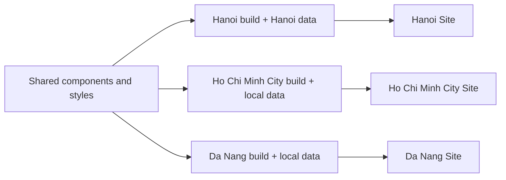

# One shared application, separate city websites

**Feasibility proposal - October 28, 2026. Not implemented.** The request is for separate city websites with the same design/features and different data. There is no visitor city dropdown. This assessment does not create additional Sites, publish new city content, change the current Hanoi application or authorize a paid service.

## Recommendation

Keep one maintained application and add a city data contract plus a release workflow that builds each city and publishes to its own hosting target. Sites can host those separate static outputs. Propagating an update across the family is work the release workflow must perform; do not assume independently created or remixed Sites inherit changes automatically.

Each city has its own URL, Site ID, saved versions, sharing settings and rollback history. One shared design change is implemented once, then built/published for all active cities. A city-only content update usually needs only that city's publication. Separate deployments do not mean independently maintained applications.

## What the current project needs

Astro already produces static output, and the UI has reusable components. Content is partly separated under `src/data`, but switching one data file is insufficient. Inspection found Hanoi-specific references in 29 source files, including:

- `src/pages/index.astro`: hero headline, local photograph and alt text.
- `src/layouts/Layout.astro`: brand, page description, search labels and footer location.
- `src/data/places.ts`: city catalog and the default map coordinates.
- `src/data/imap-prototype.ts` and `imap-featured.ts`: explorer records, stories, local assets and cross-links.
- `src/components/homepage/editorial/content.ts`, Heritage data and experiences: food, events, editorial cards and media.
- `src/lib/concierge.ts` and related controllers: Hanoi aliases, district matching, sample questions and fallback wording.

Migrate those values into city packages while retaining shared layout, map behavior, filters, typography and components. Suggested future structure (not existing commands/files): `src/cities/ha-noi/`, `src/cities/ho-chi-minh/`, `src/cities/da-nang/`, a shared `CityContent` interface, and a city-to-hosting-target registry.

Each package should supply identity/branding/SEO, approved geographic scope/default center, districts, destinations, stories, editorial sections, assistant vocabulary, copy and media references. Reuse existing content types and retain stable destination IDs, provenance and rights status. Preserve the separate editorial review requirements in `sprint-05c0-editorial-workflow.md`; this proposal does not implement its CMS or make unapproved content publishable.

## Build selection

The agent chooses the city at build time, through a validated build target or build variable. Shared application code imports the selected package through one adapter/alias. Unknown cities, incomplete required data or a city/Site-ID mismatch must stop the build; never silently fall back to Hanoi.

Generated HTML, browser data, page routes, SEO and assets must belong to the selected city and the same approved content revision. Package only publishable selected-city assets and common assets. A different default map center alone is not sufficient. Do not ship private authoring drafts or another city's data accidentally.

Astro replaces its Vite environment values during the build. Changing a hosted runtime variable on an already built static Site would not change its compiled city content: rebuild and deploy the appropriate output. Keep each target's manifest/build/output isolated so preparing Da Nang cannot overwrite Hanoi's `.openai/hosting.json` or running preview.

## Sites source and releases

The current manifest identifies only the existing Hanoi Site. Sites source credentials and hosting identity are per Site, so do not assume one unchanged hosting manifest or one Site-bound remote can represent every city.

For a Sites-first implementation, retain the current Hanoi Sites repository as the canonical shared workspace, containing shared code and city packages, with GitHub as its backup. Additional city source repositories are controlled deployment mirrors, not places to fork the UI. A release adapter opens each target's current source, reconciles its history, synchronizes the approved common revision, retains that target's identity/configuration, builds its city and uses the native source/save/deploy tools. Record the common upstream revision, city data revision and resulting target commit/version/deployment IDs. Target commits can differ while sharing the same upstream application revision.

Phone edits must enter that shared workspace first. If work starts from a city Site, the agent routes shared edits upstream and then republishes every affected city; otherwise the current convenient per-Site editing flow would permit drift. She should not need to select repositories or run build commands. Before implementing this change, update the single-Site instructions in `AGENTS.md` and `docs/operations.md` as part of the same migration; they remain correct for the current one-Site application.

For a shared UI update, prepare and validate all city builds before publishing any, save a version per target, then deploy each. Check every result. Sites has individual deployment operations; cross-Site simultaneous/transactional rollout is not established by the documentation or tools inspected. A partial failure requires retries or rollback to the previous matched release set, with an accurate status report. Never report all cities updated when one still serves the prior revision. Maintain a resumable release record so a transient failure need not involve the owner.

This can be one agent-handled request such as “Em sửa phần đầu trang cho tất cả thành phố.” It does not mean that a GitHub push or editing one live Site currently triggers deployment to the others. No unattended watcher, CI publisher or multi-city release command exists yet.

## Hosting alternatives and limits

- **Sites with an agent-managed release:** best continuity with the existing phone workflow and account. Requires the release adapter and source synchronization described above. Additional projects and higher traffic are not guaranteed by the fact that one Site currently works; confirm the actual account allowance before provisioning. Here the example family is three total Sites, including Hanoi.
- **Cloudflare Pages with Git integration:** a stronger fit if the requirement is an unattended build/deploy of every city after each shared Git push. It supports multiple projects from one repository with distinct build settings. Current documentation caps this at five Pages projects per repository unless raised; three fits that published limit. Adds account/Git integration and cloud-agent access to the shared repository; phone editing continuity would need to be proven before migration. No account or deployment was configured here.
- **Independent manual copies:** simple initially, but does not meet the shared-update requirement and increases maintenance drift. Not recommended.

Neither hosting choice requires an application database, server-side AI or CMS just to select static city data. Sites capacity, regional/commercial eligibility and any custom-domain costs still need confirmation for the expanded scope. The cost scenarios and exclusions are recorded in `docs/billing.md`.

## Implementation sequence and acceptance

1. Extract Hanoi into a typed city package while preserving its current URL, content and approved UI. Fix relevant tests against the established baseline rather than suppressing the existing test debt.
2. Add strict city selection and isolated build outputs; use clearly marked synthetic fixtures for testing only. Validate map center, district/destination links, local copy, media, SEO and absence of other-city data in every output.
3. Add the Sites target registry and resumable publish-all workflow; rehearse identity checks and partial-failure recovery without changing production audiences.
4. Obtain real, approved Ho Chi Minh City/Da Nang content and media; then provision their Sites within account limits. Do not manufacture travel facts or present Hanoi content as another city's approved catalog.
5. Prove that one shared UI revision reaches all targets, one city's data change leaves the others' content intact, and the complete previous release set can be restored. Verify phone editing against the canonical workspace. Only then describe the multi-city feature as implemented.

Sources opened October 28, 2026: [Sites projects and versions](https://learn.chatgpt.com/docs/sites/managing-a-site), [Sites publishing](https://learn.chatgpt.com/docs/sites/publishing-and-sharing), [OpenAI pricing](https://learn.chatgpt.com/docs/pricing), [Astro build-time environment values](https://docs.astro.build/en/guides/environment-variables/), [Pages projects sharing a repository](https://developers.cloudflare.com/pages/configuration/monorepos/), [Pages limits](https://developers.cloudflare.com/pages/platform/limits/). Hosting feasibility is an architectural inference from these capabilities and the existing static build, not evidence of a tested multi-Site integration.
